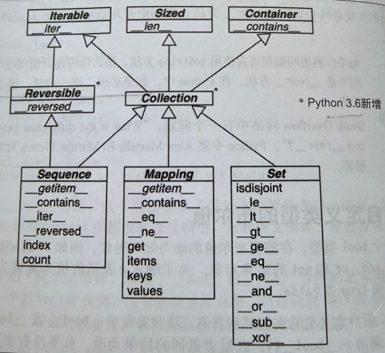

# 1 Python数据模型

可以把 Python 视为一个**框架**, 而**数据模型**就是对框架的描述, 规范语言自身各个组成部分的接口, 确定序列, 函数, 迭代器, 协程,
类, 上下文管理器等部分的行为.

使用框架要花大量时间编写方法, 交给框架调用. 利用 Python 数据模型构建新类也是如此. Python 解释器调用特殊方法(也叫*魔术方法*)来
执行基本对象操作, 通常由特殊方法触发. 特殊方法的名字前后都有**双下划线**. 例如, `obj[key]` 句法背后提供支持的是特殊方法
`__getitem__`.

再次强调, 特殊方法是供 Python 解释器调用的, 而不是你自己, 除非涉及大量元编程(Meta Programming). 唯一例外的是 `__init__`方法,
为自定义的类实现此方法时经常直接调用它以便调用超类的初始化方法.

`__repr__` 方法供内置函数 `repr()` 调用, 而 `__str__` 由 `str()` 调用.
前者生成适用于解释器读取的值, 而后者则返回对终端用户友好的字符串. `print()` 函数也是最终调用 `__str__` 方法,
如果没有实现 `__str__`, `str()` 也会调用 `__repr__`. 如果非要在这两个方法中二选一的话, 请选择 `__repr__`.

Python 中基本容器类型接口如下图所示. 图中所有的类都是**抽象基类**.

其中,
- `Sequence` 即序列, 类似于普通数组, 实现它的有 `list`, `str` 等
- `Mapping` 即映射, 包含键值对. 实现它的有 `dict`, `collections.defaultdict` 等
- `Set` 即集合, 包含的元素是不重复的. 实现它的有 `set` 和 `frozenset`

